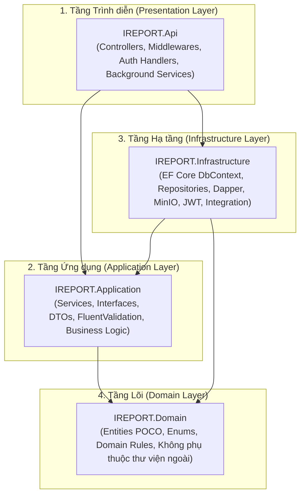
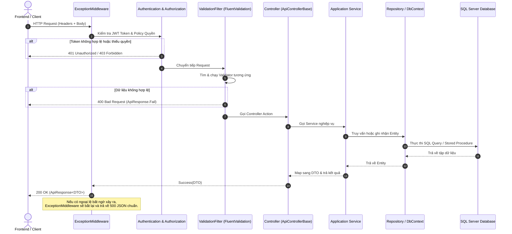

# Hướng dẫn Cấu trúc Kiến trúc Backend (Core-iReport-Api)

Tài liệu này tổng hợp chi tiết mô hình kiến trúc, quy ước thiết kế, phân chia trách nhiệm và cách tổ chức code của project **Core-iReport-Api** (.NET 8). Bạn có thể sử dụng trực tiếp tài liệu này làm **khung tham chiếu (base architecture)** để khởi tạo dự án web/API backend mới.

---

## 1. Tổng quan Kiến trúc (High-Level Architecture)

Dự án được xây dựng theo mô hình **Clean Architecture (Onion Architecture)** kết hợp nguyên lý **Domain-Driven Design (DDD)** và **Separation of Concerns (SoC)**.



### Nguyên tắc phụ thuộc (Dependency Rule)

- **Tầng trong không phụ thuộc tầng ngoài**:
  - `Domain` là tầng lõi tinh khiết (Zero external dependencies).
  - `Application` chỉ phụ thuộc vào `Domain`.
  - `Infrastructure` triển khai các Interface được định nghĩa ở `Application` và truy xuất `Domain`.
  - `Api` đóng vai trò là Host / Composition Root, kết nối toàn bộ Dependencies thông qua IoC container.

---

## 2. Công nghệ & Thư viện Cốt lõi (Tech Stack)

| Thành phần          | Công nghệ / Thư viện                   | Mục đích sử dụng                                              |
| :------------------ | :------------------------------------- | :------------------------------------------------------------ |
| **Framework**       | `.NET 8.0` (C# 12)                     | Nền tảng thực thi hiệu năng cao, LTS                          |
| **ORM chính**       | `Entity Framework Core 9` (SQL Server) | Thao tác dữ liệu quan hệ, Change Tracking, Migrations         |
| **Micro-ORM**       | `Dapper`                               | Truy vấn báo cáo phức tạp, gọi Stored Procedure hiệu năng cao |
| **Validation**      | `FluentValidation`                     | Kiểm tra dữ liệu đầu vào tự động qua Action Filter            |
| **Xác thực (Auth)** | `JWT Bearer` + `Keycloak SSO`          | Hỗ trợ đăng nhập kép (Local JWT & SSO eID qua `iss`)          |
| **Phân quyền**      | Policy-based Authorization             | `HasPermissionAttribute` kiểm tra quyền theo module/action    |
| **Lưu trữ file**    | `MinIO` (S3 API compatible)            | Quản lý tệp đính kèm, tài liệu, file kết xuất                 |
| **Xử lý Excel**     | `ClosedXML`                            | Đọc / ghi / xuất mẫu báo cáo Excel                            |
| **Tác vụ nền**      | `IHostedService` / `BackgroundService` | Chạy worker đồng bộ, sinh kỳ tự động, gửi thông báo           |
| **Tài liệu API**    | `Swagger / Swashbuckle`                | Sinh tài liệu OpenAPI và giao diện test API                   |

---

## 3. Chi tiết 4 Tầng Dự án

### 3.1. `IREPORT.Domain` (Core Domain Layer)

Chứa các thực thể mô tả dữ liệu và quy tắc bất biến của hệ thống.

```text
IREPORT.Domain/
├── Common/                # Marker interfaces (IDanhMucEntity...)
├── Enums/                 # Các enum định danh trạng thái, phân loại
└── Entities/              # Thực thể dữ liệu thuần C# (POCO)
    ├── BaoCao/            # BaoCao, BaoCaoChiTieu, BaoCaoThuocTinh, MauBaoCao...
    ├── DanhMuc/           # ChiTieu, ThuocTinh, HeSo, DonVi, DonViTachGop...
    ├── DonDoc/            # DonDocLichSu, DonDocCauHinh, DonDocKenh...
    ├── HeThong/           # NguoiDung, VaiTro, Quyen, Menu, ThongBao...
    ├── HoSo/              # HoSoBaoCao, HoSoSoLieu, HoSoPhienBan, HoSoNhatKy...
    ├── KyLich/            # KyBaoCao, LichBaoCao, ThoiGian...
    └── Workflow/          # WorkflowDuyet, QuyTrinhDuyet, BuocDuyet...
```

> **Quy ước Domain:**
>
> - Các entity không chứa code truy vấn database hay logic phụ thuộc framework.
> - Sử dụng kiểu dữ liệu rõ ràng (`int`, `string`, `DateTime`, `bool`), hỗ trợ Nullable Reference Types (`#nullable enable`).

---

### 3.2. `IREPORT.Application` (Application & Business Logic Layer)

Chứa toàn bộ Use Cases, DTOs và hợp đồng giao tiếp giữa các thành phần.

```text
IREPORT.Application/
├── Abstractions/          # Interfaces cốt lõi: ICurrentUser, IClock, IPasswordHasher...
├── Common/                # Các lớp chuẩn hóa phản hồi và xử lý chung
│   ├── ApiResponse.cs     # Chuẩn đóng gói response API: ApiResponse<T>
│   ├── AppException.cs    # Custom Exception có chứa StatusCode và Details
│   ├── BusinessDayCalculator.cs # Xử lý tính toán hạn ngày làm việc/ngày nghỉ
│   └── MessageConstants.cs # Hằng số thông báo hệ thống
├── Config/                # Strongly-typed Options classes (bind từ appsettings.json)
├── Dtos/                  # Data Transfer Objects cho Request và Response
│   ├── BaoCao/
│   ├── Common/            # PagedResult<T>, BaseFilterQuery...
│   ├── DashBoardDTO/
│   ├── DonDocDTOs/
│   └── HoSo/
├── Interfaces/            # Khai báo Hợp đồng (Contracts)
│   ├── IServices/         # Interface cho các nghiệp vụ logic (IBaoCaoService, INhapLieuService...)
│   └── IRepositories/     # Interface truy xuất dữ liệu trừu tượng
├── Services/              # Implementation của các Services nghiệp vụ
├── Validation/            # Các validator kế thừa AbstractValidator<T> của FluentValidation
└── DependencyInjection.cs # Đăng ký DI nội bộ tầng Application (AddApplication)
```

> **Quy tắc thiết kế tầng Application:**
>
> - Controller không gọi trực tiếp Repository mà luôn đi qua `Service` hoặc `Handler`.
> - Mọi dữ liệu đi vào/ra khỏi API đều sử dụng `DTO`, không expose trực tiếp Domain Entity.
> - Sử dụng `ICurrentUser` để lấy định danh người dùng hiện tại (`UserId`, `DonViId`, danh sách `Permissions`) thay vì truy cập trực tiếp `HttpContext`.

---

### 3.3. `IREPORT.Infrastructure` (Data Access & Infrastructure Layer)

Hiện thực hóa các kết nối cơ sở dữ liệu, lưu trữ tệp, bảo mật và tích hợp bên ngoài.

```text
IREPORT.Infrastructure/
├── Sql/
│   ├── IreportDbContext.cs       # DbContext kế thừa Entity Framework Core
│   ├── SpRunner.cs               # Helper thực thi Stored Procedure & Raw SQL với Dapper
│   ├── Configurations/           # Fluent API mapping cho từng Entity (tách riêng theo file)
│   │   ├── BaoCao/
│   │   ├── DanhMuc/
│   │   └── ...
│   └── Repositories/             # Implementation cụ thể của Repository interfaces
├── Storage/
│   └── MinioFileStorageService.cs # Adapter lưu trữ file trên MinIO S3
├── Security/
│   ├── BcryptPasswordHasher.cs   # Mã hóa mật khẩu an toàn với BCrypt
│   └── JwtTokenService.cs        # Sinh và giải mã JWT token nội bộ
├── Reporting/
│   ├── ExcelReportFileWriter.cs  # Đọc/ghi báo cáo Excel bằng ClosedXML
│   └── ExcelNhapLieuIO.cs
├── Integration/                  # Connectors tích hợp bên thứ ba (REST, SQL, File)
├── Migrations/                   # Database Migrations do EF Core sinh ra
└── DependencyInjection.cs        # Đăng ký DI cho tầng Infrastructure (AddInfrastructure)
```

> **Điểm nổi bật của hạ tầng:**
>
> - **EF Core Configurations tự động:** Trong `IreportDbContext.OnModelCreating`, gọi `b.ApplyConfigurationsFromAssembly(typeof(IreportDbContext).Assembly);` để tự động nạp tất cả các file cấu hình mà không cần khai báo thủ công.
> - **Hybrid EF Core + Dapper:** EF Core dùng cho các tác vụ CRUD, Change Tracking và Transaction; Dapper dùng cho các báo cáo aggregation hoặc truy vấn ma trận lớn cần tối ưu tốc độ.

---

### 3.4. `IREPORT.Api` (Presentation & Web Host Layer)

Điểm khởi đầu của ứng dụng, tiếp nhận HTTP requests và định tuyến.

```text
IREPORT.Api/
├── Controllers/
│   ├── ApiControllerBase.cs      # Base controller chuẩn hóa helper methods
│   ├── AuthController.cs         # Đăng nhập, refresh token, SSO callback
│   ├── BaoCaoController.cs       # Quản lý mẫu biểu báo cáo
│   ├── NhapLieuController.cs     # Nhập liệu số liệu báo cáo
│   └── ...
├── Auth/
│   ├── CurrentUser.cs            # Implementation của ICurrentUser từ ClaimsPrincipal
│   ├── KeycloakAuth.cs           # Smart Authentication Scheme (JWT nội bộ + Keycloak SSO)
│   └── PermissionPolicy.cs       # Custom HasPermissionAttribute & PermissionHandler
├── Infrastructure/
│   ├── ExceptionMiddleware.cs    # Global Error Handling Middleware
│   ├── ValidationFilter.cs       # Tự động trigger FluentValidation trước Controller Action
│   └── UtcDateTimeConverter.cs  # Chuẩn hóa DateTime JSON sang UTC ISO-8601
├── BackgroundServices/           # Hosted Services chạy nền
├── appsettings.json              # Cấu hình môi trường chính
└── Program.cs                    # Bootstrap ứng dụng, cấu hình Middleware pipeline
```

---

## 4. Chuẩn hóa Giao thức & Phản hồi (API Standardization)

### 4.1. Cấu trúc Response chuẩn (`ApiResponse<T>`)

Mọi Controller đều trả về định dạng JSON thống nhất:

```csharp
// Khi thành công:
{
  "success": true,
  "message": "Thành công",
  "data": { ... },
  "errors": null
}

// Khi thất bại:
{
  "success": false,
  "message": "Dữ liệu không hợp lệ.",
  "data": null,
  "errors": {
    "maBaoCao": ["Mã báo cáo không được để trống."]
  }
}
```

### 4.2. Base Controller (`ApiControllerBase`)

Các Controller kế thừa từ `ApiControllerBase` để thừa hưởng các tiện ích:

- `Me`: Đối tượng `ICurrentUser` truy cập thông tin định danh.
- `CurrentUserId`: Lấy ID người dùng hiện tại (tự ném lỗi 401 nếu chưa đăng nhập).
- `Success(data, message)`: Trả về HTTP 200 kèm `ApiResponse<T>.Ok`.
- `SuccessMsg(message)`: Trả về HTTP 200 khi thực hiện lệnh không cần trả data.

### 4.3. Phân quyền linh hoạt (`HasPermissionAttribute`)

Phân quyền theo mã quyền dạng `Module|Action` được cấu hình khai báo trực tiếp trên Action hoặc Controller:

```csharp
[HttpGet]
[HasPermission("BaoCao|Xem")]
public async Task<IActionResult> GetList()
{
    var data = await _service.GetAllAsync();
    return Success(data);
}
```

---

## 5. Quy trình Xử lý Request (Request Life Cycle)



---

## 6. Hướng dẫn Tái sử dụng làm Base Project mới

Để dựng một dự án backend mới từ bộ khung này, bạn thực hiện theo các bước sau:

### Bước 1: Khởi tạo Solution và 4 Projects

```bash
# 1. Tạo Solution
dotnet new sln -n MyProject

# 2. Tạo 4 projects
dotnet new classlib -n MyProject.Domain -o src/MyProject.Domain
dotnet new classlib -n MyProject.Application -o src/MyProject.Application
dotnet new classlib -n MyProject.Infrastructure -o src/MyProject.Infrastructure
dotnet new webapi -n MyProject.Api -o src/MyProject.Api

# 3. Add projects vào solution
dotnet sln add src/MyProject.Domain src/MyProject.Application src/MyProject.Infrastructure src/MyProject.Api

# 4. Thiết lập liên kết Dependency
dotnet add src/MyProject.Application reference src/MyProject.Domain
dotnet add src/MyProject.Infrastructure reference src/MyProject.Application src/MyProject.Domain
dotnet add src/MyProject.Api reference src/MyProject.Application src/MyProject.Infrastructure src/MyProject.Domain
```

### Bước 2: Copy các thành phần Base tái sử dụng

1. **Domain Base**: Marker interfaces, Auditable entity base (nếu cần: `CreatedDate`, `CreatedBy`, `UpdatedDate`...).
2. **Application Common**:
   - `ApiResponse.cs`, `AppException.cs`.
   - `ICurrentUser.cs` trong thư mục `Abstractions/`.
   - `DependencyInjection.cs` với phương thức `AddApplication()`.
3. **Infrastructure Core**:
   - `DbContext` kế thừa `DbContext`, gọi `ApplyConfigurationsFromAssembly` trong `OnModelCreating`.
   - `JwtTokenService.cs`, `BcryptPasswordHasher.cs`.
   - `DependencyInjection.cs` với phương thức `AddInfrastructure(IConfiguration)`.
4. **API Host Framework**:
   - `ApiControllerBase.cs`.
   - `ExceptionMiddleware.cs` & `ValidationFilter.cs`.
   - `CurrentUser.cs` & `PermissionPolicy.cs`.
   - Cấu hình `Program.cs` (setup Middleware, Authentication, CORS, Swagger).

### Bước 3: Thêm một Feature mới theo chuẩn mẫu

Khi phát triển một nghiệp vụ mới (ví dụ: Quản lý Sản phẩm `Product`):

1. **Domain**: Tạo `Product.cs` trong `MyProject.Domain/Entities/`.
2. **Infrastructure**:
   - Tạo `ProductConfiguration.cs` trong `MyProject.Infrastructure/Sql/Configurations/` (cấu hình tên bảng, độ dài cột, khóa ngoại).
   - Thêm `DbSet<Product> Products { get; }` vào `DbContext`.
3. **Application**:
   - Tạo `ProductDto.cs`, `CreateProductRequest.cs` trong `MyProject.Application/Dtos/Product/`.
   - Tạo `CreateProductRequestValidator.cs` kế thừa `AbstractValidator<CreateProductRequest>`.
   - Khai báo `IProductService.cs` và hiện thực `ProductService.cs`.
   - Đăng ký DI `services.AddScoped<IProductService, ProductService>();` trong `DependencyInjection.cs`.
4. **Api**:
   - Tạo `ProductController.cs` kế thừa `ApiControllerBase`.
   - Thêm các Action API (`[HttpGet]`, `[HttpPost]`, `[HasPermission("Product|Create")]`).

---

## 7. Cấu trúc Thư mục Chuẩn Tham khảo (Full Template)

```text
MyProject/
├── src/
│   ├── MyProject.Domain/
│   │   ├── Common/
│   │   ├── Entities/
│   │   └── Enums/
│   │
│   ├── MyProject.Application/
│   │   ├── Abstractions/       # ICurrentUser, IClock...
│   │   ├── Common/             # ApiResponse, AppException...
│   │   ├── Dtos/               # Request & Response DTOs
│   │   ├── Interfaces/         # IServices & IRepositories
│   │   ├── Services/           # Business Services Implementation
│   │   ├── Validation/         # FluentValidation rules
│   │   └── DependencyInjection.cs
│   │
│   ├── MyProject.Infrastructure/
│   │   ├── Sql/
│   │   │   ├── MyProjectDbContext.cs
│   │   │   ├── Configurations/ # EntityTypeConfigurations
│   │   │   └── Repositories/
│   │   ├── Security/           # JWT, Password Hasher
│   │   ├── Storage/            # MinIO / S3 Adapter
│   │   ├── Migrations/
│   │   └── DependencyInjection.cs
│   │
│   └── MyProject.Api/
│       ├── Controllers/        # ApiControllerBase & Resource Controllers
│       ├── Auth/               # CurrentUser, Policy Handlers
│       ├── Infrastructure/     # ExceptionMiddleware, ValidationFilter
│       ├── appsettings.json
│       └── Program.cs
│
└── MyProject.sln
```
